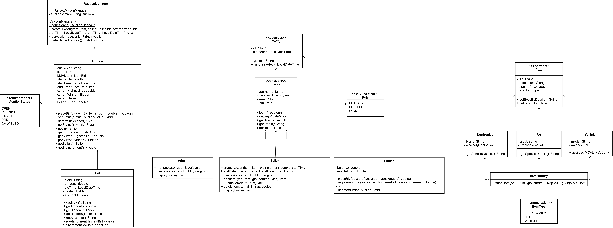

# Hệ thống Đấu giá Trực tuyến (Online Auction System)

> **Môn học:** Lập trình nâng cao  
> **Kiến trúc hệ thống:** Mô hình Client–Server (giao tiếp qua Socket/REST với định dạng dữ liệu JSON) kết hợp mô hình MVC  
> **Công nghệ phát triển:** Java 21, JavaFX (FXML + SceneBuilder), Maven, JUnit 5, GitHub Actions  

---

## 1. Giới thiệu hệ thống

Hệ thống đấu giá trực tuyến (Online Auction System) là nền tảng cho phép nhiều người dùng tham gia đặt giá cạnh tranh để mua sản phẩm trong một khoảng thời gian xác định (mô phỏng mô hình eBay Auctions). Giá bán cuối cùng của sản phẩm không cố định mà được quyết định thông qua quá trình đặt giá minh bạch, cạnh tranh giữa các bên mua.

### Các chức năng cốt lõi
* **Quản lý người dùng:** Hỗ trợ đăng ký, đăng nhập và phân quyền 3 vai trò: `Bidder` (người tham gia đấu giá), `Seller` (người đăng bán sản phẩm), và `Admin` (quản trị viên hệ thống).
* **Quản lý sản phẩm (CRUD):** Cho phép người bán tạo mới, cập nhật, xóa và theo dõi thông tin sản phẩm (tên, mô tả, giá khởi điểm) theo các danh mục đặc thù.
* **Tham gia đấu giá thời gian thực:** Tiếp nhận lượt đặt giá từ người mua, kiểm tra tính hợp lệ và bước giá tối thiểu, cập nhật giá mới tức thời tới toàn bộ các client đang theo dõi.
* **Kết thúc phiên tự động:** Tự động đóng phiên khi hết thời gian, xác định người thắng cuộc và luân chuyển chu trình trạng thái: `OPEN` → `RUNNING` → `FINISHED` → `PAID` / `CANCELED`.
* **Xử lý lỗi & Ngoại lệ:** Xử lý và ngăn chặn các hành vi sai quy chế (đặt giá thấp hơn mức sàn, đấu giá khi phiên đã đóng, lỗi định dạng dữ liệu, ngắt kết nối mạng).
* **Xử lý đấu giá đồng thời (Concurrency):** Áp dụng lập trình đa luồng và đồng bộ hóa an toàn (`synchronized`, `ReentrantLock`) nhằm ngăn chặn tranh chấp bộ nhớ (race condition) và mất lượt đặt giá (lost update).
* **Giao diện người dùng (JavaFX GUI):** Xây dựng giao diện trực quan bằng JavaFX kết hợp SceneBuilder và file FXML.

---

## 2. Danh sách thành viên nhóm

| STT | Họ và tên | Mã sinh viên |
|:---:|:---|:---:|
| 1 | **Lê Đức Thiện Sang** | 25020778 |
| 2 | **Lê Anh Tuấn** | 25020806 |
| 3 | **Đỗ Mạnh Hùng** | 25020597 |
| 4 | **Hoàng Thế Công Minh** | 25020696 |
| 5 | **Trần Mạnh Quân** | 25020771 |

---

## 3. Sơ đồ thiết kế lớp UML (Class Diagram)

  

